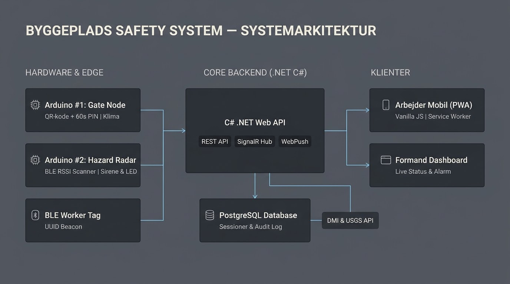
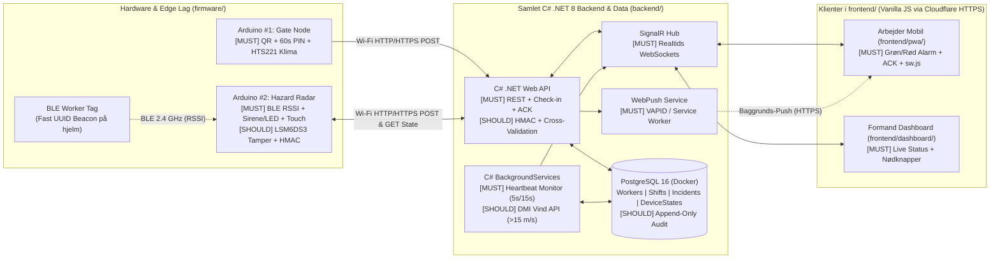
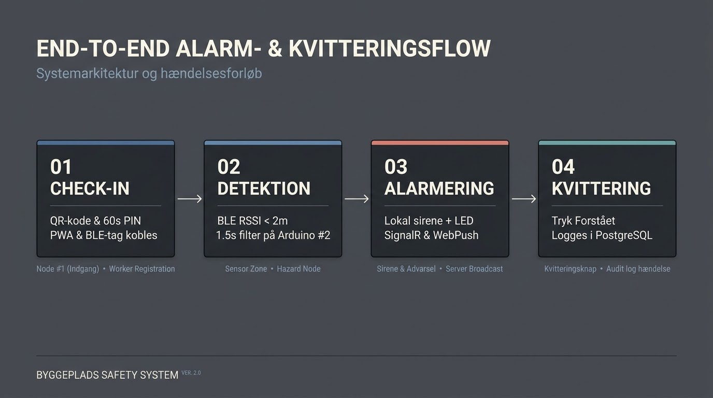
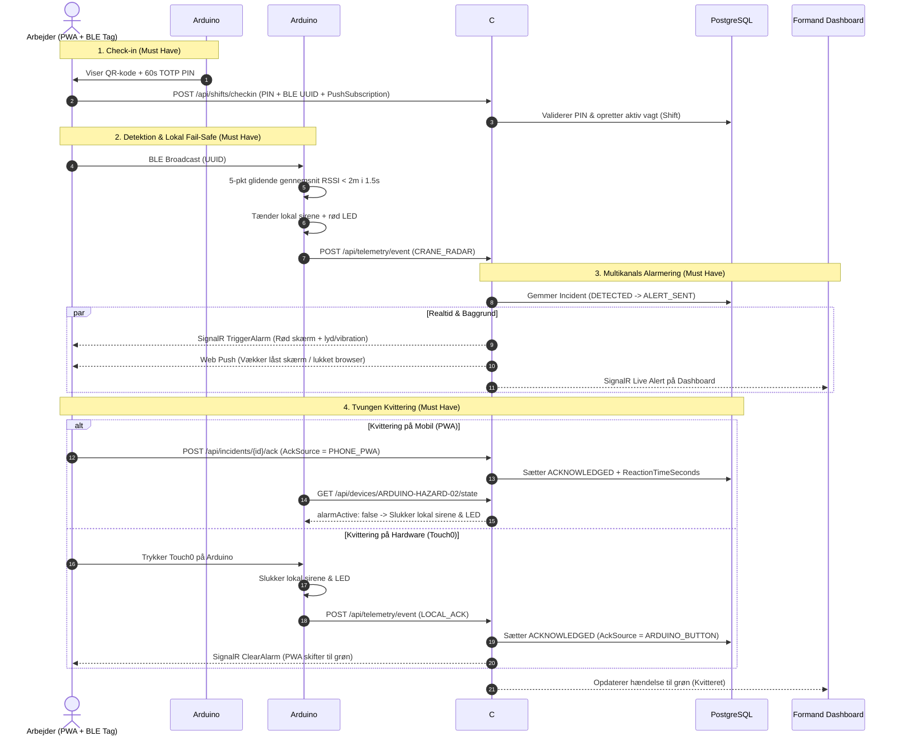
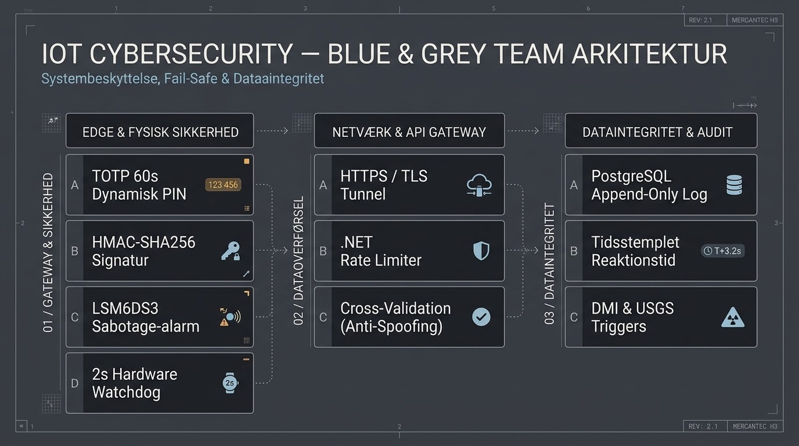
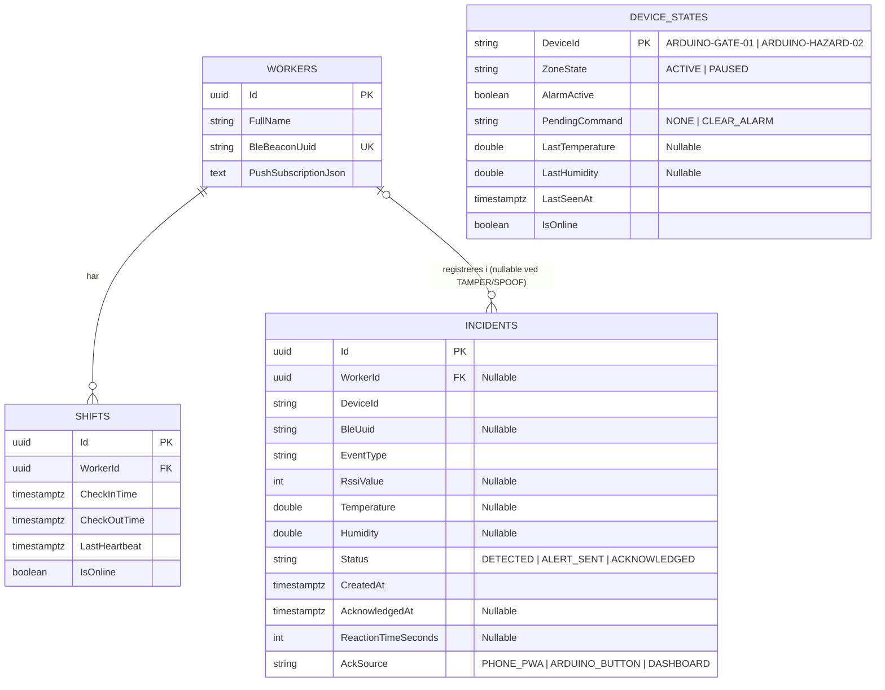

# Byggeplads Safety System — Systemarkitektur & Projektgrundlag

* **Team:** Oleh & Roman (`Person A`: Hardware & Embedded C++ | `Person B`: C# Backend, PWA & Security)
* **Periode:** 16. november 2026 — 10. december 2026
* **Milepæle:** `v0.1-mvp` (20. nov) $\rightarrow$ `v0.2-core` (27. nov) $\rightarrow$ `v0.3-security` (4. dec) $\rightarrow$ `v1.0-release` (10. dec)

---

## 1. Projektbeskrivelse & Afgrænsning

### Problemstilling
På byggepladser opstår kritiske ulykker, når medarbejdere træder ind i aktive farezoner (kranløft, højspænding, åbne skakter) eller arbejder under farlige klimaforhold. GPS fungerer ikke indendørs og mangler præcision på $1\text{–}3\text{ m}$ afstand, mens tunge native mobilapps skaber friktion ved opstart.

### Løsning
Et fokuseret, driftssikkert IoT-system bygget på to **Arduino MKR WiFi 1010**-enheder (`firmware/` med `NINA-W102 3.0.1+` firmware til samtidig Wi-Fi og BLE), én samlet **C# (.NET 8 Web API)** backend (`backend/`) med **SignalR** og **Web Push**, en **PostgreSQL 16**-database samt en letvægts **PWA** og **Formand Dashboard** (`frontend/` i Vanilla JS), der åbnes øjeblikkeligt via QR-kode uden app-installation.

---

## 2. Prioriteret Definition of Done (MoSCoW)

For at sikre et 100 % fungerende, gennemtestet og forklarligt kernesystem før udvidelser er kravene opdelt efter **MoSCoW-modellen**:

| Prioritet | Måldato | Konkrete krav (Definition of Done) |
| :--- | :--- | :--- |
| **MUST HAVE** *(Kernesystemet — skal med)* | **20. nov** (`v0.1-mvp`) & **27. nov** (`v0.2-core`) | 1. **Samtidig Wi-Fi & BLE:** Begge Arduino-boards kører `NINA 3.0.1+` firmware stabilt uden pauser. 2. **Gate Node (`Arduino #1`):** Viser QR-kode + $60\text{ s}$ dynamisk TOTP PIN-kode på displayet og måler temperatur/fugtighed (`HTS221`) hvert $30\text{ s}$. 3. **Hazard Radar (`Arduino #2`):** Scanner BLE-tags med **5-punkts glidende gennemsnit** på `RSSI` og $1.5\text{ s}$ `Debounce`, tænder lokal sirene + rød LED (*Hardware Fail-Safe*) og understøtter lokal kvittering (`Touch0`). 4. **Backend & Realtid:** C# `.NET 8 Web API` + `PostgreSQL` gemmer vagter og hændelser; `SignalR` skifter åben PWA til rød alarmskærm. 5. **Baggrunds-Push:** `Web Push` (`Service Worker`) leverer alarm til låst skærm / lukket browser. 6. **Tvungen kvittering & Drift:** Alarm stopper først ved tryk på *«Forstået»* i PWA eller på Arduino; reaktionstid gemmes i DB; $5\text{ s}$ `Heartbeat` + $2\text{ s}$ `Watchdog` overvåger enhederne; Formand Dashboard viser live status og nødknap. |
| **SHOULD HAVE** *(Cybersecurity & Vejr — hvis tiden holder)* | **4. dec** (`v0.3-security`) | 1. **Pakkesignering:** `HMAC-SHA256` signatur + $5\text{ s}$ NTP-timestamp på alle Arduino-requests. 2. **Anti-Spoofing (`Cross-Validation`):** Afviser/flagger klonede BLE-tags (`SECURITY_SPOOF`), hvis tagget ses uden aktivt check-in. 3. **Sabotagealarm:** Indbygget `LSM6DS3` accelerometer på `Arduino #2` udløser `SECURITY_TAMPER` ved fysisk flytning/stød. 4. **Audit-integritet:** PostgreSQL `Append-Only` audit-beskyttelse på `Incidents` (`REVOKE DELETE`) + `.NET RateLimiter` mod PIN brute-force. 5. **Vejrintegration:** Letvægts C# `BackgroundService` henter vindhastighed fra **DMI Open Data API** ($>15\text{ m/s}$ kranadvarsel). |
| **NICE TO HAVE** *(Ekstra — kun ved overskud)* | **8. dec** (`v1.0-release`) | 1. **iOS Safari Onboarding-wizard:** Automatisk guide (*«Del $\rightarrow$ Føj til hjemmeskærm»*) for iPhone-brugere. 2. **USGS Jordskælvs-API:** Automatisk seismisk alarm (kan ellers udløses manuelt via Formand Dashboard). 3. **Dataeksport:** Download af hændelses- og reaktionstidslog som CSV/JSON. |

---

## 3. Systemarkitektur (Visuel og Tekstuel)

---

## 4. End-to-End Hændelses- og Kvitteringsflow (`Must Have`)

---

## 5. Arkitektoniske Valg (Kort begrundelse)

| Komponent | Valg | Begrundelse |
| :--- | :--- | :--- |
| **Hardware (`firmware/`)** | `2 × Arduino MKR WiFi 1010` + `IoT Carrier` (C++) | SAMD21 har kun $32\text{ KB}$ RAM (udelukker Python). Med `NINA 3.0.1+` kører Wi-Fi og BLE parallelt i én C++-løkke. |
| **Backend (`backend/`)** | `C# (.NET 8 Web API)` + `SignalR` + `EF Core` | Ét samlet sprog på serversiden (inkl. `BackgroundService` til heartbeat og DMI vejr-polling) gør koden overskuelig, let at debugge og nem at forsvare til eksamen. |
| **Frontend (`frontend/`)** | `Vanilla JS` + `Service Worker` (`pwa/` & `dashboard/`) | Ingen tung Blazor WASM-download over mobilnetværk; øjeblikkelig opstart fra QR-kode og direkte adgang til `Web Push`. |
| **Transport** | `HTTPS` via **Cloudflare Tunnel** (+ LAN HTTP for Arduino) | Påkrævet af moderne mobilbrowsere for at tillade `Service Worker`, `Web Push` og `Vibration API`. |
| **Database** | `PostgreSQL 16` (Docker) | Hurtig opsætning i Docker, indbygget `JSONB` til push-nøgler og nem opsætning af `Append-Only` (`REVOKE DELETE`) rettigheder. |

---

## 6. IoT Cybersecurity (`Should Have` — Blue & Grey Team)

| Trussel | Team | Mekanisme | Effekt |
| :--- | :--- | :--- | :--- |
| **Check-in hjemmefra (foto af QR)** | Grey Team | $60\text{ s}$ dynamisk TOTP PIN på `Arduino #1` | Afviser udløbet PIN (`HTTP 401`) |
| **Kloning af BLE-tag (`Spoofing`)** | Grey Team | `Cross-Validation` mod aktiv vagt i DB | Udløser `SECURITY_SPOOF` alarm |
| **Falske sensorpakker (`Replay`)** | Grey Team | `HMAC-SHA256` signatur + $5\text{ s}$ `Timestamp` | Afviser manipulerede/gamle pakker |
| **Fysisk flytning af radar** | Blue Team | `LSM6DS3` accelerometer på `Arduino #2` | Udløser `SECURITY_TAMPER` alarm |
| **Netværksudfald / frossen kode** | Blue Team | $2\text{ s}$ Hardware Watchdog + $5\text{ s}$ Heartbeat | Auto-reboot / `RADAR OFFLINE` |
| **Sletning af log / Brute-force** | Blue Team | PostgreSQL `Append-Only` + `.NET RateLimiter` | Uforanderlig historik & PIN-beskyttelse |

---

## 7. Databasemodel (`PostgreSQL 16`)

