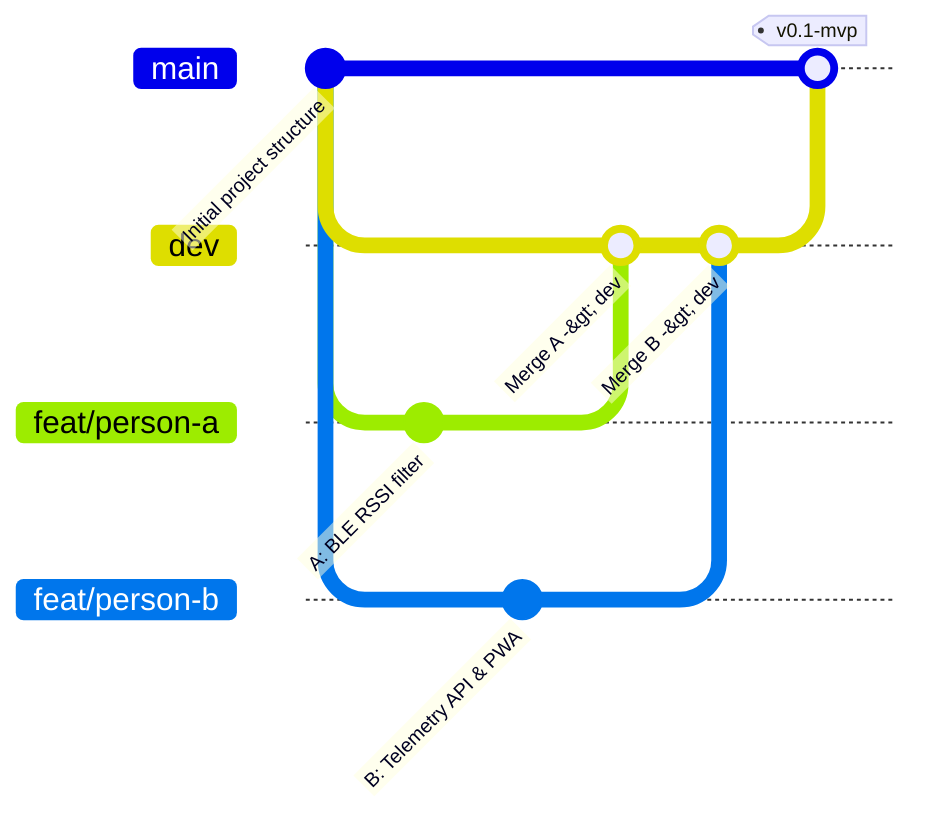

# Git & Produktions-Workflow — Byggeplads Safety System

Dette dokument beskriver vores Git-branching-model og samarbejdsproces for et 2-mands team (**Person A** & **Person B**), så vi undgår merge-konflikter og altid har en stabil kodebase klar til fremvisning og eksamen.

---

## 1. Branch-struktur (4 kerne-branches)



| Branch | Formål & Regler | Hvem arbejder her? |
| :--- | :--- | :--- |
| `main` | **Production / Release branch.** Indeholder kun 100 % gennemtestet kode ved milepæle (`v0.1-mvp`, `v0.2-core`, `v0.3-security`, `v1.0-release`). Opdateres **kun** via Pull Request (PR) fra `dev`. | Ingen direkte commits. |
| `dev` | **Integration / Staging branch.** Her samles og testes Person A's firmware og Person B's backend + frontend sammen. | Begge (via merge/PR fra arbejds-branches). |
| `feat/person-a` | **Person A's arbejdsbranch.** Alt arbejde i `firmware/` (`gate-node-01/`, `hazard-radar-02/`, `shared/`). | **Person A** (Hardware & C++). |
| `feat/person-b` | **Person B's arbejdsbranch.** Alt arbejde i `backend/`, `frontend/` og `docker-compose.yml` (C#, PWA, Dashboard, DB). | **Person B** (Backend & Frontend). |

---

## 2. Mappe-ejerskab (Ingen Merge-konflikter!)

For at sikre at Person A og Person B aldrig overskriver hinandens filer:
* **Person A ejer:** `firmware/` og `docs/plan-person-a.md`
* **Person B ejer:** `backend/`, `frontend/`, `docker-compose.yml` og `docs/plan-person-b.md`
* **Fælles filer (`AGENTS.md`, `docs/architecture.md`):** Ændringer i API-kontrakten aftales mundtligt og merges straks til `dev`.

---

## 3. Daglig Arbejdsrutine (Cheat Sheet)

### Når du starter dagen (hent nyeste ændringer fra `dev`):
```bash
# Person A:
git checkout feat/person-a
git pull origin dev

# Person B:
git checkout feat/person-b
git pull origin dev
```

### Når du har lavet en feature og vil dele den med din makker på `dev`:
```bash
# 1. Gem og push til din egen branch
git add .
git commit -m "feat(radar): add 5-point moving average RSSI filter"
git push origin feat/person-a   # (eller feat/person-b)

# 2. Merge ind i dev (enten via GitHub Pull Request eller lokalt):
git checkout dev
git pull origin dev
git merge feat/person-a         # (eller feat/person-b)
git push origin dev

# 3. Skift tilbage til din egen arbejdsbranch:
git checkout feat/person-a
```

### Ved Milepæl (Fredage: `v0.1-mvp`, `v0.2-core`, `v0.3-security`, `v1.0-release`):
1. Begge parter merger deres kode ind i `dev` og kører en fysisk End-to-End test.
2. Opret en **Pull Request på GitHub fra `dev` $\rightarrow$ `main`**.
3. Den anden person godkender (Review & Approve) og merger PR'en.
4. Sæt et Git-tag på `main`:
   ```bash
   git checkout main
   git pull origin main
   git tag -a v0.1-mvp -m "Milestone 1: End-to-End MVP"
   git push origin v0.1-mvp
   ```
